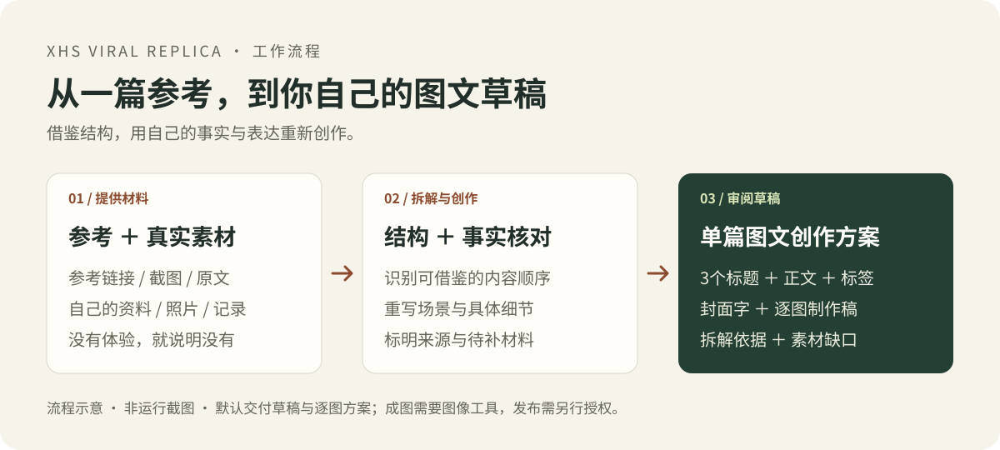

# 小红书参考拆解与创作

**给一篇参考笔记，加上你自己的素材，产出标题、正文、封面文案和逐图制作稿。**

适合看到一篇好笔记、想借鉴结构，却不知道怎么写成自己内容的创作者、产品负责人和运营人员。借鉴结构，用自己的事实与表达写新稿。默认只制作草稿。

[看完整示例](examples/public-demo.md) · [开始使用](#开始使用) · [下载最新版技能包](https://github.com/yingzao-studio/xhs-viral-replica/releases/latest)



## 你会拿到什么

- **单篇草稿：**3个备选标题、推荐标题、正文和标签。
- **图文制作方案：**封面字、逐图画面与文案、需要补拍或提供的素材。
- **拆解依据：**参考内容的可见结构、可迁移部分、事实来源和待补信息。

没有亲身体验时，可以写选购核对清单或待实测方案，不会把产品规格写成“我用了一个月”。文字与逐图稿不等于已生成图片，成图需要宿主提供图像工具。

## 先看一个完整示例

[通勤杯演示：参考结构 → 标题、正文与4张逐图稿](examples/public-demo.md)

| 输入 | 拆解与迁移 | 输出片段 |
| --- | --- | --- |
| 参考短文：选文件盒前，先量书架可用宽度 | 提取“先量容纳空间，再对照物品尺寸”的顺序 | 标题：选通勤杯前，先量一下你放杯子的地方 |
| 演示材料：杯架内宽约7厘米，候选杯身最宽处8厘米 | 用新场景和材料重新写，不照搬原文 | 封面字：先量杯架，再选杯 |
| 没有实际使用记录、没有实物照片 | 写购买前核对事项，标明待补图片 | 完整正文、标签和逐图制作稿见示例 |

**这是虚构材料演示，不是真实测评或客户成绩；尚未成图、未发布，无流量与成交数据。**上方图片仅解释工作流程。

## 开始使用

### 方式一：普通聊天用户

<!-- PUBLIC-ACCESS:START -->
1. 打开[完整技能文本](通用提示词.txt)，复制全文，或保存为TXT。
2. 在DeepSeek、豆包、ChatGPT等模型中新建对话，粘贴全文；支持附件时也可上传TXT。
3. 发送下面的任务说明，附上参考笔记和自己的素材。

[三平台使用步骤](三平台使用说明.md) · [完整文本直链](https://raw.githubusercontent.com/yingzao-studio/xhs-viral-replica/main/%E9%80%9A%E7%94%A8%E6%8F%90%E7%A4%BA%E8%AF%8D.txt)
<!-- PUBLIC-ACCESS:END -->

### 方式二：支持Skill的工具用户

1. [下载最新版技能包](https://github.com/yingzao-studio/xhs-viral-replica/releases/latest)，解压并保留完整的`xhs-viral-replica`文件夹。
2. 按当前工具的技能目录要求安装，新开对话或刷新技能列表，确认可以调用。
3. 使用下面的指令。不要只复制`SKILL.md`而遗漏`references`。

[详细安装说明](安装与使用.md) · [平台兼容与未测范围](references/platform-compatibility.md)

### 复制这段，开始第一篇

```text
使用 xhs-viral-replica，拆解下面的参考，用我的真实素材写1篇小红书图文草稿。
只借鉴结构，不照搬原文，不虚构体验或互动数据，本次只做草稿。
缺资料时，最多先问三个关键问题。

参考笔记：[粘贴链接、截图或原文]
我的主题：[准备写什么]
我的真实素材：[产品资料、照片、自己的记录等；没有体验就写没有]
```

只给参考，也可以先拆解；要创作草稿，还需主题和至少一项自己的可核实素材。受众和目标不知道时可留空，先根据资料提出待确认方向。

## 能力与适用范围

技能不自带平台登录、联网、图片模型或发布权限。链接无法读取时，使用你提供的截图或文本；只有标题时只分析标题，不猜正文、封面和互动数据。不保证流量或成交。

公开下载不代表官方技能目录收录。普通聊天参考、文件存储与原生技能安装是不同能力；能否完整读取附件及执行指令，取决于实际环境。

- ChatGPT原生技能目录包仅适用于账号具备相应上传入口的情况。
- DeepSeek Harness目录方式与普通聊天文本方式分别说明，见[平台兼容记录](references/platform-compatibility.md)。
- 豆包原生技能导入缺少官方格式与客户端实测依据，未标为已验证。
- 跨环境是适配设计，未声称所有模型或客户端均已实测通过。

## 进阶使用

- [更多调用模板](references/prompt-template.md)：补充产品、素材、篇数与交付要求。
- [技能入口](SKILL.md)：查看拆解、创作与检查方法。
- [跨环境适配](references/agent-adaptation.md)：确认工具、路径、输出和恢复方式。
- [共用记录与交接](references/shared-contract.md)：沿用已确认的素材和事实。

想把零散素材整理成7天排期，可以配合[xhs-content-loop](https://github.com/yingzao-studio/xhs-content-loop)。本技能负责参考拆解与单篇创作，两者可独立使用。

## 版本、验证与许可

当前技能版本：**v2.1.3**。[版本记录](CHANGELOG.md) · [更新说明](更新说明.md) · [验证结果](验证结果.md) · [规范核验来源](references/standards-review.md)

基础结构审计与同一助手的四种情形手工试跑，和独立模型效果评测分开报告。尚未完成独立跨模型回归、真实平台发布或增长效果验证。[行为评估用例](evals/README.md)不把手写演示或结构通过算作成功案例。

使用技能无需安装Python依赖。维护者可运行：

```sh
python -m pip install -r requirements-dev.txt
python -X utf8 scripts/validate_package.py
```

结构检查不等于模型效果评测。GitHub检查状态以实际Actions结果为准。Release中的附件以对应发布版本为准；仓库最新文档可能包含后续改进。

采用[MIT许可证](LICENSE)，第三方与历史素材范围见[许可说明](THIRD_PARTY.md)。通用包不含私人原始Excel、第三方原图、账号凭据或历史业务台账，也不包含原私有仓库的历史记录。

## English quick start

Turn a reference Xiaohongshu / RED note and your own source material into a reviewable draft: three title options, body text, tags, cover copy and a per-image production plan. Learn from structure without copying wording or inventing personal experience.

For plain chat, paste or upload [the complete instructions](skill.txt). For skill-enabled tools, download the [latest package](https://github.com/yingzao-studio/xhs-viral-replica/releases/latest) and follow your host's installation instructions. Browsing and image generation require host tools. The public example is synthetic, not a customer result; cross-platform behavior has not been independently verified.

## 使用反馈与支持

试用遇到问题，欢迎[提交Issue](https://github.com/yingzao-studio/xhs-viral-replica/issues)，提供模型与工具、去敏后的最小输入、预期结果、实际结果及失败阶段。不要提交证件、凭据、买家信息或无权公开的截图。

如果这套流程对你有用，欢迎 **Star收藏**，方便下次找到；也欢迎提交可公开复现的改进案例。
